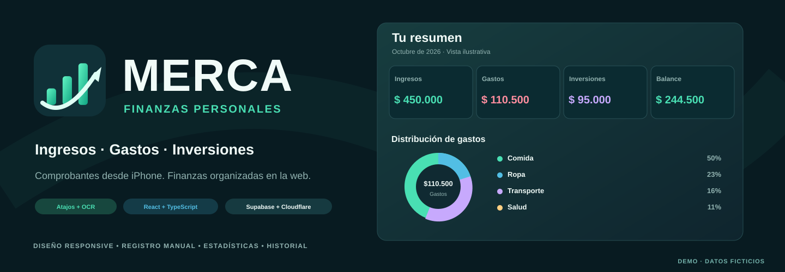
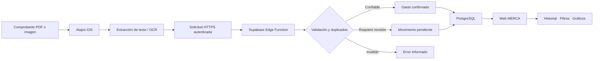
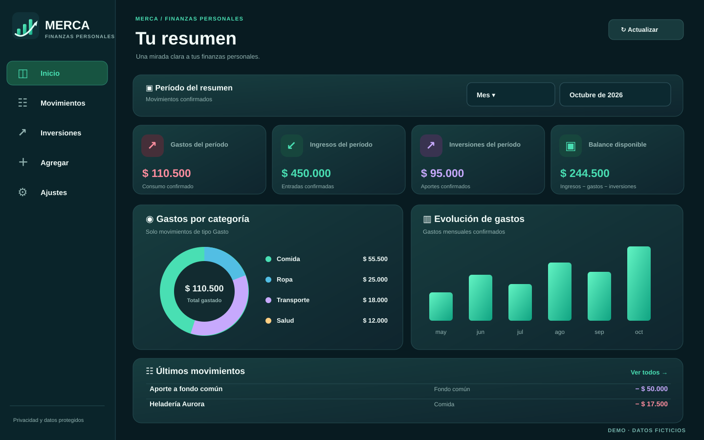
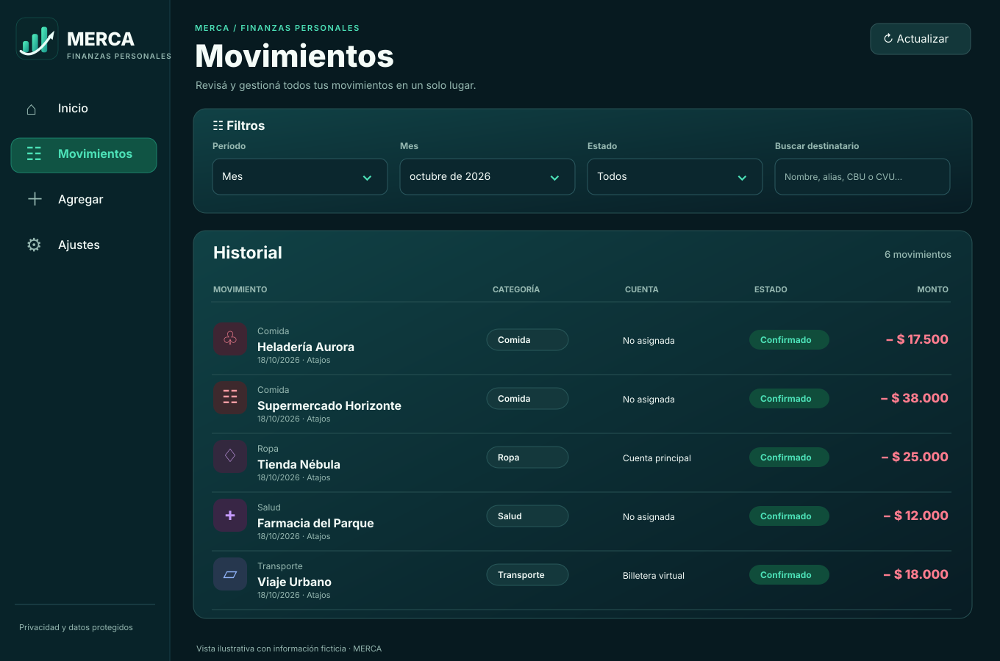
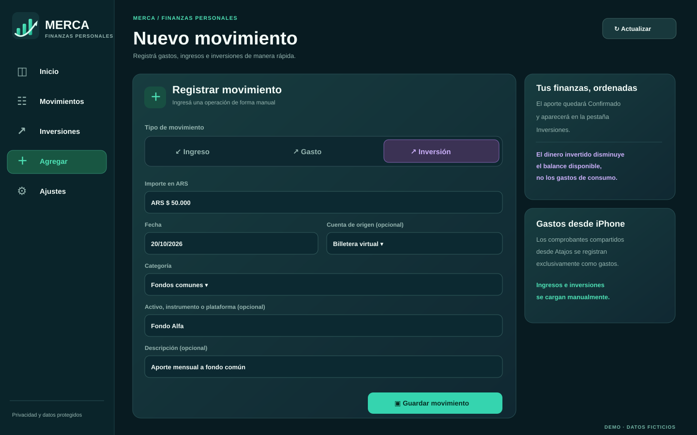
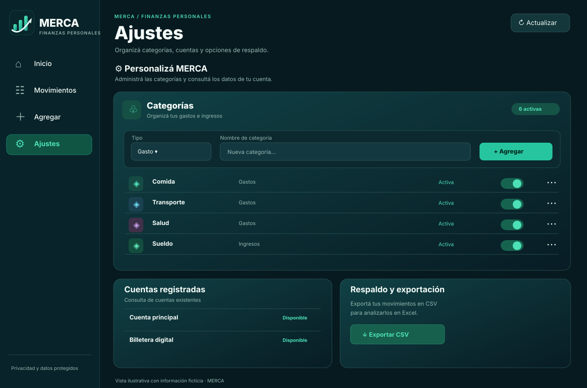
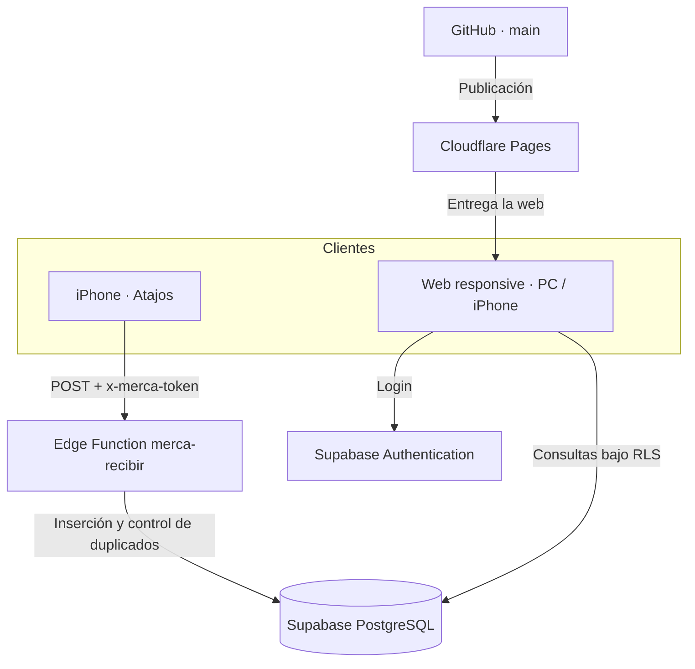

<div align="center">


# MERCA

### Aplicación web de finanzas personales con registro de gastos desde iPhone

**Desarrollo web · Automatización iOS · OCR · Bases de datos · Procesamiento de comprobantes**


**[Funcionamiento](#funcionamiento) · [Interfaz](#interfaz-y-funcionalidades) · [Arquitectura](#arquitectura-del-sistema) · [Configuración](#puesta-en-marcha) · [Seguridad](#seguridad-y-privacidad)**

</div>



> **Las imágenes de este README son representaciones de la interfaz con datos ficticios.** Los importes, destinatarios y cuentas fueron creados para documentar el proyecto. No corresponden a finanzas reales ni representan funciones adicionales a las implementadas.

## Descripción general

**MERCA** es una aplicación web para registrar, consultar y analizar ingresos y gastos personales, diseñada para utilizarse desde una computadora o un iPhone.

El proyecto surge de una necesidad cotidiana: reducir la carga manual de gastos realizados mediante billeteras virtuales y, al mismo tiempo, conservar un historial organizado que permita entender **cuánto se gasta, en qué categorías y durante qué período**.

Su característica principal es la integración con **Atajos de iOS**. Desde el menú *Compartir* de un comprobante en PDF o imagen, un atajo extrae el texto mediante OCR o lectura del documento, solicita una categoría y envía los datos a una función de Supabase. El servidor interpreta la información, evita registros duplicados y guarda el gasto. La aplicación web permite luego consultar, corregir y analizar los movimientos.

La solución utiliza servicios con opciones gratuitas, evita depender de WhatsApp o de una aplicación iOS nativa y no necesita almacenar las imágenes originales de los comprobantes.

## Funcionalidades principales

| Módulo | Implementación |
| --- | --- |
| **Registro desde iPhone** | Compartir comprobantes PDF o imágenes mediante Atajos de iOS. |
| **Reconocimiento de comprobantes** | Extracción y normalización de importes, fechas, horas, referencias de operación y destinatarios cuando están presentes. |
| **Gastos automáticos** | Los comprobantes compartidos se clasifican como **gastos**, independientemente del titular de origen o destino. |
| **Ingresos manuales** | Se registran exclusivamente desde la aplicación web. |
| **Inversiones manuales** | Aportes con categorías independientes, historial exclusivo y descuento del balance disponible sin mezclarse con los gastos. |
| **Validación y duplicados** | Comprobación de datos, referencias de operación y huellas de texto para evitar altas repetidas. |
| **Revisión excepcional** | Operaciones con datos insuficientes o formatos no confiables requieren intervención desde la web. |
| **Inicio** | Resumen de ingresos, gastos y balance; gráfico por categorías; evolución mensual y últimos movimientos. |
| **Movimientos** | Historial con búsqueda por destinatario, filtros de fechas y estado, edición, confirmación y descarte. |
| **Nuevo movimiento** | Carga manual de ingresos y gastos, fecha, categoría, descripción y cuenta opcional cuando existe una cuenta configurada. |
| **Ajustes** | Creación, cambio de nombre, activación y desactivación de categorías; consulta de cuentas y exportación CSV. |
| **Acceso** | Inicio de sesión mediante Supabase Authentication y separación de información por usuario. |
| **Interfaz** | Diseño responsive en modo oscuro, favicon y acceso directo desde la pantalla de inicio del iPhone. |

## Funcionamiento

El recorrido de un comprobante es el siguiente:

1. Se obtiene un comprobante de pago o transferencia en el iPhone.
2. Desde **Compartir**, se ejecuta el atajo de MERCA.
3. El atajo obtiene el texto del **PDF** o extrae texto de una **imagen** y permite elegir la categoría.
4. Se envía una solicitud HTTPS a la **Supabase Edge Function** `merca-recibir`.
5. El servidor interpreta y valida la información, busca duplicados y, cuando corresponde, registra el movimiento en PostgreSQL.
6. La aplicación web consulta los movimientos mediante Supabase y los incorpora al historial, los filtros y las estadísticas.



### Procesamiento y criterio de confiabilidad

El receptor reconoce estructuras conocidas de comprobantes, incluyendo formatos de **Mercado Pago**, y contempla particularidades del texto extraído de algunos PDF: por ejemplo, centavos en superíndice que pueden quedar unidos al importe al convertirse a texto.

La detección de un número no es suficiente para confirmarlo. MERCA procura comprobar que la **fecha y el importe sean consistentes**, y evita inferir valores cuando existen varias interpretaciones posibles. La referencia de operación se utiliza para prevenir duplicados; cuando no está disponible, puede emplearse una huella del texto normalizado.

Para el **destinatario**, se prioriza el nombre de la persona o comercio. Si no aparece, el procesamiento puede utilizar un alias o un identificador como CBU/CVU de destino, siempre que pueda distinguirlo del origen. El campo puede corregirse manualmente desde la web.

El sistema distingue tres resultados visibles desde Atajos:

| Mensaje | Significado |
| --- | --- |
| **Movimiento cargado exitosamente** | Se registró un gasto confirmado o ya existía un registro confirmado equivalente. |
| **Transacción a confirmar** | La operación quedó registrada, pero requiere revisión. |
| **Error al cargar el movimiento** | No se pudo registrar de forma válida. |

**Regla de clasificación:** cualquier comprobante compartido mediante Atajos se trata como gasto. **Los ingresos se cargan desde la aplicación web**, no desde el atajo. Esta decisión simplifica el flujo y evita solicitar el tipo de operación cada vez que se comparte un archivo.

## Interfaz y funcionalidades

La aplicación dispone de **cinco pestañas**. El estilo visual se construyó con una paleta oscura azulada, acentos turquesa, componentes responsive e íconos de **Lucide**.

### Inicio — Resumen financiero



La pantalla principal concentra la información del período seleccionado: **ingresos, gastos, inversiones y balance disponible**, distribución porcentual de gastos por categoría, evolución de los últimos seis meses y movimientos recientes. Los gráficos utilizan movimientos reales consultados desde la base de datos; los pendientes y descartados no se contabilizan como gastos o ingresos confirmados.

Los filtros permiten consultar un **mes, día, rango de fechas o todo el historial**. También es posible acceder desde Inicio a los movimientos pendientes.

### Movimientos — Historial y corrección



El historial presenta cada operación con su **categoría, destinatario, fecha, origen, cuenta asociada cuando existe, estado e importe**. Incluye:

- Filtros combinables por período y estado.
- Búsqueda por nombre, alias, CBU o CVU del destinatario.
- Edición de monto, fecha, hora, tipo, categoría, descripción, destinatario y estado.
- Confirmación o descarte de movimientos pendientes.
- Identificación visual de categorías y estados.

La columna **Cuenta** muestra la cuenta registrada cuando está vinculada al movimiento. En caso contrario, se indica **«No asignada»**; el sistema no presupone qué cuenta se utilizó.

### Inversiones — Aportes y seguimiento

MERCA permite crear **categorías de inversión independientes** (por ejemplo, Fondo común, Acciones o Plazo fijo) y registrar aportes manuales con importe, fecha, cuenta de origen opcional, activo/plataforma y descripción. La pestaña **Inversiones** ofrece historial, filtros por período, categoría y estado, edición y distribución de aportes.

Los importes invertidos **reducen el balance disponible**, pero no se cuentan como gastos de consumo ni se incluyen en el gráfico de gastos. La sección registra dinero aportado; **no calcula rentabilidad, cotizaciones ni valor de mercado de activos**. Consultá [implementación y migración de inversiones](docs/inversiones.md).

### Nuevo movimiento — Carga manual



El formulario permite registrar **gastos, ingresos e inversiones** con importe en pesos argentinos, fecha, categoría y descripción. Los gastos admiten un destinatario o comercio. Si el usuario tiene cuentas configuradas, puede asociar opcionalmente la cuenta de origen o destino.

Se incluyen validación de importes, categorías activas según el tipo de movimiento y un botón para limpiar el formulario. Las operaciones manuales se crean **confirmadas**.

### Ajustes — Categorías y respaldo



Las categorías de **gastos, ingresos e inversiones** se pueden **crear, renombrar, activar y desactivar** sin eliminar los movimientos históricos que las utilizan. También se muestran las cuentas existentes en modo consulta, la identidad de la sesión y la exportación de movimientos a **CSV**, compatible con herramientas como Excel.

La creación o administración de cuentas bancarias desde esta pantalla **no está implementada**; su visualización y la selección opcional en formularios sí lo están.

## Arquitectura del sistema

MERCA separa la interfaz, la autenticación, la recepción de comprobantes y el almacenamiento:



### Tecnologías empleadas

| Tecnología | Uso en MERCA |
| --- | --- |
| **React 18** | Componentes e interacción de la interfaz web. |
| **TypeScript 5** | Tipado de movimientos, categorías, formularios y componentes. |
| **Vite 6** | Desarrollo, compilación y generación de archivos estáticos. |
| **CSS** | Diseño responsive, tarjetas, controles, gráficos y estilos visuales. |
| **Lucide React** | Iconografía de navegación, categorías, estados y acciones. |
| **Supabase JavaScript SDK** | Acceso autenticado a datos desde la web. |
| **Supabase Auth** | Gestión de usuarios y sesiones. |
| **Supabase PostgreSQL** | Persistencia de cuentas, categorías y movimientos. |
| **Row Level Security (RLS)** | Aislamiento de registros mediante `user_id`. |
| **Supabase Edge Functions** | Recepción HTTPS y procesamiento de comprobantes. |
| **Atajos de iOS / OCR** | Captura y extracción de texto al compartir archivos. |
| **Cloudflare Pages** | Alojamiento y publicación del frontend conectado a GitHub. |
| **GitHub Actions** | Verificación automática de TypeScript y compilación. |

### Modelo de datos

La información principal se distribuye en tres tablas:

| Tabla | Datos relevantes |
| --- | --- |
| `categorias` | Usuario, nombre, tipo (`gasto`/`ingreso`), color y estado activo. |
| `cuentas` | Usuario, nombre, tipo de cuenta, moneda y estado. |
| `movimientos` | Usuario, tipo, importe, fecha, hora, categoría, cuentas asociadas, destinatario, descripción, origen del registro, referencia externa y estado. |

Los movimientos admiten los estados `confirmado`, `pendiente_revision` y `descartado`. La base de datos utiliza claves foráneas y políticas RLS para evitar que un usuario consulte o modifique registros ajenos.

La información se guarda de forma estructurada; **no se conservan los PDF, las imágenes ni el texto OCR completo** como historial de comprobantes.

## Puesta en marcha

### Requisitos

- Node.js compatible con Vite 6 (se utiliza **Node.js 22** en CI).
- Un proyecto propio de **Supabase** con Authentication, PostgreSQL y las tablas/políticas de MERCA configuradas.
- Navegador moderno para la web. Para el flujo automático, un iPhone con **Atajos**.

### 1. Ejecutar el frontend

```bash
git clone https://github.com/BaltazarPatane/MERCA-APP.git
cd MERCA-APP
npm install
cp .env.example .env
```

Completar en `.env` las **variables publicables** del proyecto Supabase:

```dotenv
VITE_SUPABASE_URL=https://TU-PROYECTO.supabase.co
VITE_SUPABASE_PUBLISHABLE_KEY=TU_CLAVE_PUBLICABLE
```

Iniciar el entorno local:

```bash
npm run dev
```

Para compilar y previsualizar:

```bash
npm run build
npm run preview
```

> El repositorio incluye la aplicación web y una migración para `destinatario`, pero **no incluye una instalación automatizada del esquema completo de PostgreSQL ni el despliegue completo de la Edge Function**. Para replicar toda la solución es necesario configurar esos componentes en un proyecto Supabase propio.

### 2. Publicar en Cloudflare Pages

La configuración del frontend es:

| Parámetro | Valor |
| --- | --- |
| Repositorio | `BaltazarPatane/MERCA-APP` |
| Rama de producción | `main` |
| Framework | React / Vite |
| Comando de compilación | `npm run build` |
| Carpeta de salida | `dist` |
| Variables públicas | `VITE_SUPABASE_URL`, `VITE_SUPABASE_PUBLISHABLE_KEY` |

Los commits integrados a `main` pueden desplegarse automáticamente a través de la integración de GitHub con Cloudflare Pages. La configuración del backend de Supabase es independiente.

### 3. Configurar el atajo en el iPhone

El atajo de uso personal recibe contenido desde el menú **Compartir** de iOS, obtiene texto del PDF o imagen, permite elegir categoría y envía:

```json
{
  "texto_ocr": "Contenido extraído del comprobante",
  "categoria": "Comida"
}
```

a la función HTTPS `merca-recibir`. La autenticación se realiza mediante el encabezado `x-merca-token`, cuyo valor debe coincidir con un secreto configurado exclusivamente en el backend.

Los **secretos administrativos, el token del atajo y cualquier clave de servicio** no deben incorporarse al frontend ni subirse a GitHub.

El código de la Edge Function utilizada en el despliegue del proyecto se administró y publicó **por separado desde Supabase**; la documentación histórica de su integración se encuentra en [`docs/comprobantes.md`](docs/comprobantes.md). No se debe confundir el despliegue de Cloudflare Pages con el de la función.

## Seguridad y privacidad

MERCA se diseñó para mantener **público el código** sin publicar los datos personales:

- **Supabase Authentication** gestiona el acceso a la web.
- **RLS** restringe las operaciones a los registros asociados al usuario autenticado.
- La web utiliza únicamente la **clave publicable** de Supabase.
- Los privilegios del servidor y los secretos de ingesta pertenecen al entorno de **Edge Functions**, nunca al navegador.
- Se evita guardar archivos originales y texto OCR completo.
- El identificador de operación permite detectar reenvíos y reducir la posibilidad de duplicados.

El endpoint de ingesta desde Atajos está configurado para un **usuario propietario**. Crear usuarios adicionales en Supabase no configura automáticamente un atajo independiente para cada uno.

## Evolución del desarrollo

| Etapa | Implementación |
| --- | --- |
| **Captura iOS** | Comparación de alternativas y selección de Atajos para trabajar con PDF e imágenes compartidas. |
| **Persistencia** | Modelado de categorías, cuentas y movimientos en PostgreSQL; integridad referencial y políticas RLS. |
| **Backend** | Edge Function de ingesta, validación de comprobantes, reconocimiento de importe/fecha y prevención de duplicados. |
| **Reconocimiento** | Tratamiento de formatos reales de Mercado Pago, fechas en español, centavos extraídos de PDF e identificación de destinatarios. |
| **Web inicial** | React, autenticación, filtros, historial, resumen, cargas manuales y CSV. |
| **Gestión** | Edición de movimientos, altas y cambios en categorías, revisión de pendientes y asociación opcional de cuentas. |
| **Inversiones** | Tipo de movimiento y categorías propios, historial filtrable y cálculo independiente del balance disponible. |
| **Publicación** | Integración GitHub + Cloudflare Pages, variables de entorno públicas y compilaciones automáticas. |
| **Diseño v2** | Rediseño responsive de Inicio, Movimientos, Nuevo movimiento y Ajustes; identidad gráfica e ícono para iPhone. |

## Estructura del repositorio

```text
MERCA-APP/
├── public/
│   ├── icon.svg                  # Favicon y marca
│   ├── apple-touch-icon.png      # Acceso directo en iPhone
│   └── manifest.webmanifest      # Metadatos de instalación
├── src/
│   ├── components/
│   │   ├── InicioPanel.tsx
│   │   ├── MovimientosPanel.tsx
│   │   ├── InversionesPanel.tsx
│   │   ├── NuevoMovimientoPanel.tsx
│   │   ├── AjustesPanel.tsx
│   │   ├── GestionCategorias.tsx
│   │   └── EditarMovimiento.tsx
│   ├── lib/supabase.ts
│   ├── App.tsx
│   ├── main.tsx
│   ├── styles.css
│   └── types.ts
├── supabase/migrations/          # Migración del destinatario
├── docs/
│   ├── comprobantes.md
│   └── img/                      # Imágenes ilustrativas del proyecto
├── .github/workflows/            # Verificación de compilación
├── .env.example
├── index.html
├── package.json
└── README.md
```

## Alcance actual y mejoras posibles

La versión actual cubre el flujo de **gastos enviados desde iPhone** y la administración de finanzas desde la web, pero conserva algunos límites importantes:

- El reconocimiento automático está validado para **determinados formatos de comprobantes**, no para cualquier PDF bancario.
- Si el importe, fecha o estructura son ambiguos, el sistema puede requerir revisión o rechazar la solicitud.
- La exportación CSV utiliza los movimientos cargados en la sesión; la consulta solicita hasta **3000 registros** y el límite efectivo puede depender de la configuración de Supabase. **No equivale a un sistema de backup integral**.
- No hay restauración de respaldos ni paginación histórica completa.
- Las cuentas pueden mostrarse y asociarse a movimientos manuales; todavía no existe administración completa de cuentas desde la web.
- Para activar **Inversiones** en una base de datos existente es necesario ejecutar [la migración SQL](supabase/migrations/20261020_inversiones.sql), que amplía los tipos permitidos sin borrar registros.
- El frontend se despliega desde GitHub, pero la ingesta de comprobantes requiere desplegar y configurar la Edge Function de manera independiente.

## Autor

<div align="center">

**MERCA — Registro y análisis de finanzas personales**

Diseño, desarrollo e integración por **Baltazar Patané**.

*React · TypeScript · PostgreSQL · Supabase · Automatización con Atajos iOS*

</div>
